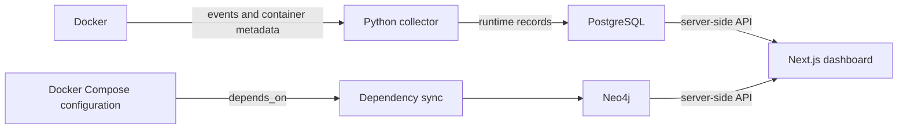

# Docker Runtime State and Dependency Tracking

The collector records Docker container lifecycle events and current state in PostgreSQL. Declared service dependencies come from Docker Compose configuration and are synchronized to Neo4j.



## Why two databases?

- **PostgreSQL** is the primary relational store for services, containers, current status, and event history. Existing views and the event trigger continue to provide status updates and dashboard queries.
- **Neo4j** stores declared service-to-service dependencies as directed `(:Service)-[:DEPENDS_ON]->(:Service)` relationships, including the Compose dependency condition. It supports graph traversal and downstream impact queries.

Runtime health remains in PostgreSQL. A declared dependency is not evidence that either service is healthy, and downstream impact is a potential relationship-based impact, not a guarantee that an outage propagates.

## Requirements and configuration

Use Python 3.10 or newer, Node.js 20 or newer, Docker with Compose, PostgreSQL 16, and Neo4j 5. The root Compose file starts Neo4j by default; its optional PostgreSQL service is for isolated setups only. The sample application topology is in `demo/docker-compose.yml`.

Use `.env.example` as a template for local settings, but do not copy it over an existing `.env` or store real credentials on a shared filesystem. On this Arch setup the active values are in `$HOME/.config/runtime-tracker/env` with mode `0600`; load them before Compose, collector, or dashboard commands:

```sh
set -a
. "$HOME/.config/runtime-tracker/env"
set +a
```

The file points PostgreSQL at the existing native database and uses its current host authentication, so it does not contain a PostgreSQL password. For other machines, start from `.env.example`; omit `PGPASSWORD` when host authentication does not require it. Keep credentials private and do not overwrite an existing `.env`.

| Variable | Purpose |
| --- | --- |
| `PGHOST`, `PGPORT`, `PGDATABASE`, `PGUSER`, `PGPASSWORD` | PostgreSQL connection for collector and dashboard |
| `NEO4J_URI`, `NEO4J_USERNAME`, `NEO4J_PASSWORD` | Neo4j connection for sync and server-side dashboard APIs |
| `COMPOSE_FILE` | Compose file used as the declared dependency source (default `demo/docker-compose.yml`) |
| `GRAPH_PROJECT_NAME` | Stable namespace for graph service IDs (default `runtime-tracker`) |

Do not replace an existing `.env` or commit credentials. Use the Neo4j credentials already configured for the running server.

Start infrastructure:

```sh
docker compose -f docker-compose.yml up -d neo4j
```

`COMPOSE_FILE` points graph sync at `demo/docker-compose.yml`, so use `-f docker-compose.yml` for the infrastructure stack. This uses the native PostgreSQL service on `127.0.0.1:5432`. To deliberately start the optional Compose PostgreSQL in a separate environment, set a separate `COMPOSE_PGPASSWORD` and opt in with `docker compose -f docker-compose.yml --profile compose-postgres up -d postgres`; it binds to port `5433` by default and uses a separate data volume.

Initialize a fresh PostgreSQL database with the existing project SQL files:

```sh
psql -h "$PGHOST" -p "$PGPORT" -U "$PGUSER" -d "$PGDATABASE" -f db/schema.sql
psql -h "$PGHOST" -p "$PGPORT" -U "$PGUSER" -d "$PGDATABASE" -f db/triggers.sql
psql -h "$PGHOST" -p "$PGPORT" -U "$PGUSER" -d "$PGDATABASE" -f db/views.sql
psql -h "$PGHOST" -p "$PGPORT" -U "$PGUSER" -d "$PGDATABASE" -f db/indexes.sql
```

For an existing database, back it up before applying `db/migrations/001_remove_mongo_ref.sql` once to `runtime_tracker`. It drops only the Mongo-specific reference column and rebuilds the event history view; it preserves event rows and all other data. Never initialize the schema on an existing populated database.

## Run the collector

The collector requires access to the Docker daemon, PostgreSQL, and Neo4j. Install dependencies and start it from the repository root:

```sh
python -m venv .venv
. .venv/bin/activate
pip install -r collector/requirements.txt
python collector/collector.py
```

At startup, the collector synchronizes existing containers into PostgreSQL, then synchronizes the configured Compose dependency graph to Neo4j. It then listens to Docker events and inserts structured lifecycle records into PostgreSQL. Neo4j synchronization can also be run on demand:

```sh
python collector/graph_sync.py
```

Synchronization is idempotent. Service node IDs combine the Compose project namespace and service key. Every run updates nodes and relationships, stores `depends_on` conditions (`service_started` for short syntax), removes stale dependency edges, and removes nodes for services removed from that project's source file. It does not derive dependencies from container names or event order. Graph sync runs at collector startup or when invoked directly; rerun it after editing Compose configuration.

## Run the dashboard

The Next.js server uses PostgreSQL and Neo4j credentials only on the server. The browser calls Next.js API routes and never connects to either database directly.

```sh
cd dashboard
npm ci
npm run dev
```

Open <http://localhost:3000>. The overview shows current containers, `/events` shows PostgreSQL event history, and `/dependencies` shows the declared graph from Neo4j. The graph API is `/api/dependencies`; query examples are available at `/api/dependencies/query?service=api&kind=direct` (supported kinds: `direct`, `dependents`, `transitive`, `impact`).

## Queries

Existing PostgreSQL examples are in `db/queries.sql`. For example, read event history and current status:

```sql
SELECT container_name, service_name, event_type, event_time
FROM container_event_history
ORDER BY event_time DESC;

SELECT service_name, container_name, current_state, restart_count
FROM current_container_status
ORDER BY service_name, container_name;
```

Neo4j query examples (use a parameter such as `$service_id`):

```cypher
// List all services
MATCH (s:Service) RETURN s.name, s.project ORDER BY s.name;

// Direct dependencies of a service
MATCH (s:Service {service_id: $service_id})-[r:DEPENDS_ON]->(d:Service)
RETURN d.name, r.condition ORDER BY d.name;

// Services that directly depend on it
MATCH (s:Service {service_id: $service_id})<-[:DEPENDS_ON]-(d:Service)
RETURN d.name ORDER BY d.name;

// All transitive dependencies
MATCH (s:Service {service_id: $service_id})-[:DEPENDS_ON*1..]->(d:Service)
WHERE d <> s RETURN DISTINCT d.name ORDER BY d.name;

// Potential downstream impact (services depending directly or indirectly on it)
MATCH p=(s:Service {service_id: $service_id})<-[:DEPENDS_ON*1..]-(d:Service)
WHERE d <> s RETURN d.name, min(length(p)) AS dependency_distance
ORDER BY dependency_distance, d.name;
```

An unknown service or a service with no matching dependencies returns an empty result. Queries use declared relationships; combine them with PostgreSQL runtime status to assess current health.

## End-to-end demonstration

1. Start PostgreSQL and Neo4j, initialize PostgreSQL as above, install Python dependencies, and export `.env` values.
2. Run `python collector/graph_sync.py`. The default `demo/docker-compose.yml` produces `frontend → api`, `api → postgres`, and `api → redis` in Neo4j. The Compose demo currently uses short `depends_on` syntax, so those relationships use `service_started`.
3. Start `python collector/collector.py` in a terminal. Run a container that is available on your Docker host, for example `docker run --rm --name tracker-demo-nginx -d nginx`; verify lifecycle rows in PostgreSQL:

   ```sql
   SELECT c.name, e.event_type, e.event_time
   FROM container_event e JOIN container c USING (container_id)
   WHERE c.name = 'tracker-demo-nginx'
   ORDER BY e.event_time;
   ```

4. Stop it with `docker stop tracker-demo-nginx` and query again. The PostgreSQL trigger updates the associated current status when lifecycle events arrive.
5. Open `/dependencies` or query Neo4j with `MATCH (s:Service)-[r:DEPENDS_ON]->(d:Service) RETURN s.name, r.condition, d.name ORDER BY s.name, d.name;`.
6. Edit a `depends_on` entry in the selected Compose file and rerun `python collector/graph_sync.py`. The graph updates without duplicates and stale edges are removed.

## Preserved PostgreSQL features

The existing service/container/status/event/network schema, service dependency table, status trigger, SQL views, indexes, and example queries remain. Docker event records no longer carry a MongoDB document reference; MongoDB-only raw-event storage is removed.

## Limitations

- The dependency source is one configured Compose file. For multiple files, set `COMPOSE_FILE` to the merged Compose configuration path or a pre-rendered configuration file; the collector does not invoke Docker Compose to merge files.
- The sample Compose topology is illustrative and separate from the root database infrastructure Compose file.
- The graph page is a hierarchical list, not a force-directed graph. It clearly shows the dependent-to-required arrow and Compose condition.
- Event history retains structured Docker event fields in PostgreSQL, not the complete raw event payload.
