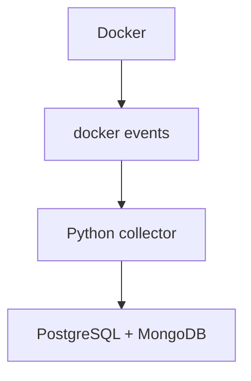
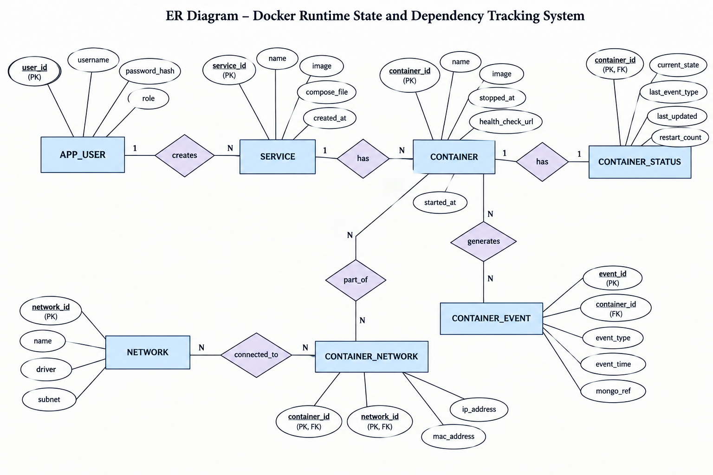

# Docker Runtime State and Dependency Tracking System
## Monitors Docker containers and captures their events in real time. Docker provides an event stream through docker events
## Python collector listens to this stream and sends the event information to two databases.
## PostgreSQL for structured information such as containers, services, networks, container status, and event history
## MongoDB to preserve the original Docker event as a JSON-like document
### The purpose is to make both the current runtime state and historical runtime events queryable.

### Relational schema

**APP_USER**
`APP_USER(user_id PK, username UNIQUE, password_hash, role)`

**SERVICE**
`SERVICE(service_id PK, name UNIQUE, image, compose_file, created_at)`

**CONTAINER**
`CONTAINER(container_id PK, service_id FK → SERVICE(service_id), name, image, started_at, stopped_at, health_check_url)`

**CONTAINER_STATUS**
`CONTAINER_STATUS(container_id PK, FK → CONTAINER(container_id), current_state, last_event_type, last_updated, restart_count)`

**CONTAINER_EVENT**
`CONTAINER_EVENT(event_id PK, container_id FK → CONTAINER(container_id), event_type, event_time, mongo_ref)`

**NETWORK**
`NETWORK(network_id PK, name, driver, subnet)`

**CONTAINER_NETWORK**
`CONTAINER_NETWORK(container_id PK, FK → CONTAINER(container_id), network_id PK, FK → NETWORK(network_id), ip_address, mac_address)`

### er diagram:

