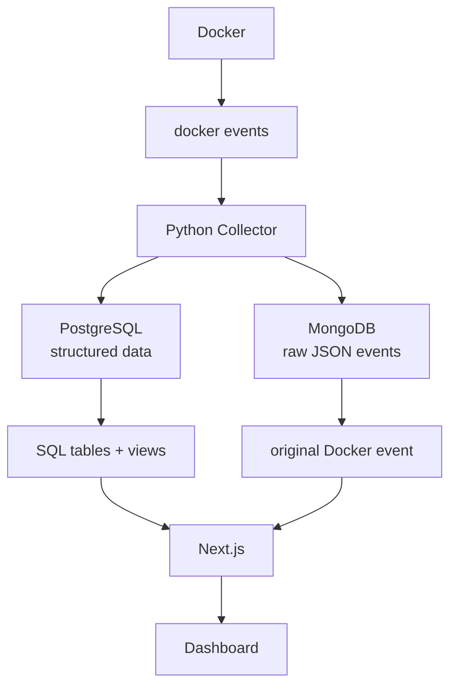

# Docker Runtime State and Dependency Tracking System
## Monitors Docker containers and captures their events in real time. Docker provides an event stream through docker events
## Python collector listens to this stream and sends the event information to two databases.
## PostgreSQL for structured information such as containers, services, networks, container status, and event history
## MongoDB to preserve the original Docker event as a JSON-like document
### The purpose is to make both the current runtime state and historical runtime events queryable.


### Relational schema

**APP_USER**
`APP_USER(user_id PK, username UNIQUE, password_hash, role)`

**SERVICE**
`SERVICE(service_id PK, name UNIQUE, image, compose_file, created_at)`

**CONTAINER**
`CONTAINER(container_id PK, service_id FK → SERVICE(service_id), name, image, started_at, stopped_at, health_check_url)`

**CONTAINER_STATUS**
`CONTAINER_STATUS(container_id PK, FK → CONTAINER(container_id), current_state, last_event_type, last_updated, restart_count)`

**CONTAINER_EVENT**
`CONTAINER_EVENT(event_id PK, container_id FK → CONTAINER(container_id), event_type, event_time, mongo_ref)`

**NETWORK**
`NETWORK(network_id PK, name, driver, subnet)`

**CONTAINER_NETWORK**
`CONTAINER_NETWORK(container_id PK, FK → CONTAINER(container_id), network_id PK, FK → NETWORK(network_id), ip_address, mac_address)`

### er diagram:


## Executing instructions

## 1. Start MongoDB

MongoDB is running inside a Docker container named `runtime-tracker-mongo`.


```bash
docker start runtime-tracker-mongo
```


---

## 2. Open MongoDB Shell

MongoDB is running inside the Docker container, so open its MongoDB shell using:

```bash
docker exec -it runtime-tracker-mongo mongosh
```

Select the project's database:

```javascript
use runtime_events
```

Check the collections:

```javascript
show collections
```

The project uses the `events` collection.

To view one stored Docker event:

```javascript
db.events.findOne()
```


MongoDB stores the original Docker event as a document. Different Docker event types can contain different fields, so the document structure does not need to be identical for every event.

---

## 3. Start the Python Collector

Open another terminal:

Start the collector:

```fish
python collector/collector.py
```


The collector listens to Docker's real-time event stream and stores the information in both databases.

---

## 4. PostgreSQL

Open another terminal:

```bash
psql -U tracker -d runtime_tracker -h localhost
```

Check the tables:

```sql
\dt
```

The main relational tables are:

```text
app_user
service
container
container_status
container_event
network
container_network
```

---

## 5. Check PostgreSQL Data

View services:

```sql
SELECT * FROM service;
```

View current container status:

```sql
SELECT * FROM container_status;
```

View recorded events:

```sql
SELECT
    event_id,
    container_id,
    event_type,
    event_time,
    mongo_ref
FROM container_event
ORDER BY event_time DESC;
```

PostgreSQL stores the structured representation of the runtime information.

---

## 6. PostgreSQL View

The project contains a view called:

```text
current_container_status
```

Display it:

```sql
SELECT * FROM current_container_status;
```

The view combines information from multiple relational tables to provide a convenient representation of the current runtime state.

---

## 7. PostgreSQL Trigger

The project uses a trigger on `container_event`.

Check the trigger:

```sql
SELECT
    trigger_name,
    event_manipulation,
    event_object_table
FROM information_schema.triggers
WHERE event_object_table = 'container_event';
```

The trigger automatically updates `container_status` when a new relevant Docker event is inserted.

For example:

```sql
SELECT
    c.name,
    cs.current_state,
    cs.last_event_type,
    cs.restart_count
FROM container c
JOIN container_status cs
    ON c.container_id = cs.container_id
WHERE c.name = 'demo-api-1';
```

This demonstrates that the current runtime state can be derived and maintained automatically from incoming events.

---

# 8. SQL Queries

The project SQL queries are stored in:

```text
db/queries.sql
```

The file contains examples of:

* JOIN
* GROUP BY
* HAVING
* Aggregate functions
* Subqueries
* Correlated subqueries
* ORDER BY

Important examples include:

### Current status of containers

```sql
SELECT
    c.name AS container,
    s.name AS service,
    cs.current_state,
    cs.restart_count
FROM container c
JOIN service s
    ON c.service_id = s.service_id
JOIN container_status cs
    ON c.container_id = cs.container_id
ORDER BY s.name;
```

### Number of events per container

```sql
SELECT
    c.name AS container,
    COUNT(e.event_id) AS total_events
FROM container c
LEFT JOIN container_event e
    ON c.container_id = e.container_id
GROUP BY c.container_id, c.name
ORDER BY total_events DESC;
```

### Containers that experienced failures

```sql
SELECT
    c.name,
    c.image
FROM container c
WHERE c.container_id IN (
    SELECT DISTINCT container_id
    FROM container_event
    WHERE event_type IN ('die', 'kill')
);
```

### Most recent event for every container

```sql
SELECT
    c.name AS container,
    e.event_type,
    e.event_time
FROM container c
JOIN container_event e
    ON c.container_id = e.container_id
WHERE e.event_time = (
    SELECT MAX(e2.event_time)
    FROM container_event e2
    WHERE e2.container_id = e.container_id
)
ORDER BY e.event_time DESC;
```

---

# 9. MongoDB Aggregation

MongoDB is also used for analysis of the raw event documents.

Inside `mongosh`:

```javascript
use runtime_events
```

Run:

```javascript
db.events.aggregate([
  {
    $group: {
      _id: "$docker_event.Action",
      count: { $sum: 1 }
    }
  },
  {
    $sort: {
      count: -1
    }
  }
])
```

This groups the raw Docker event documents by event type.

Example output:

```text
start
die
create
kill
stop
destroy
restart
```

---

## 10. Live Docker Event Demonstration

Open another terminal and create a test container:

```fish
docker run --name viva-test-nginx -d nginx
```

The Python collector should immediately display events similar to:

```text
EVENT: create | viva-test-nginx | ...
EVENT: start  | viva-test-nginx | ...
```

The event has now been generated by an actual Docker container.

---

## 11. Verify the Event in PostgreSQL

Run:

```sql
SELECT
    c.name AS container,
    e.event_type,
    e.event_time
FROM container_event e
JOIN container c
    ON e.container_id = c.container_id
WHERE c.name = 'viva-test-nginx'
ORDER BY e.event_time;
```

The events generated by the container should now appear in PostgreSQL.

---

## 12. Verify the Raw Event in MongoDB

Inside `mongosh`:

```javascript
db.events.find({
  "docker_event.Actor.Attributes.name": "viva-test-nginx"
})
```

MongoDB will contain the corresponding raw Docker event documents.

This demonstrates that the same real Docker event has been processed into two representations:

---

# 13. Generate Another Event

Stop the test container:

```fish
docker stop viva-test-nginx
```

The collector should receive events such as:

```text
EVENT: die  | viva-test-nginx | ...
EVENT: stop | viva-test-nginx | ...
```

Check PostgreSQL again:

```sql
SELECT
    c.name,
    e.event_type,
    e.event_time
FROM container_event e
JOIN container c
    ON e.container_id = c.container_id
WHERE c.name = 'viva-test-nginx'
ORDER BY e.event_time;
```

The new events should now be visible.

The container can then be started again:

```fish
docker start viva-test-nginx
```

This generates another `start` event.

---

### PostgreSQL

Stores structured relational information:

* Containers
* Services
* Container status
* Event metadata
* Networks
* Container-network relationships
* Users

This allows relational queries, joins, aggregation, constraints, views and triggers.

### MongoDB

Stores the original Docker event documents.

This is useful because different Docker event types can have different fields and structures. MongoDB allows these heterogeneous documents to be stored without modifying the PostgreSQL relational schema for every variation.

### Python Collector

Acts as the bridge between Docker and the databases.

It:

1. Listens to Docker's event stream.
2. Identifies the event and container.
3. Updates structured information in PostgreSQL.
4. Stores the original event document in MongoDB.

The system therefore maintains both a **structured relational representation** and the **original event data**.


