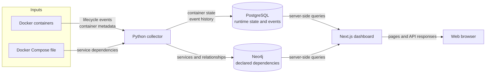

# Docker Runtime State and Dependency Tracking

The collector records Docker container lifecycle events and current state in PostgreSQL. Declared service dependencies come from Docker Compose configuration and are synchronized to Neo4j.



## Why two databases?

- **PostgreSQL** is the primary relational store for services, containers, current status, and event history. Existing views and the event trigger continue to provide status updates and dashboard queries.
- **Neo4j** stores declared service-to-service dependencies as directed `(:Service)-[:DEPENDS_ON]->(:Service)` relationships, including the Compose dependency condition. Runtime containers are separate `:Container` nodes keyed by full Docker ID, and Compose instances link to their logical service using `:INSTANCE_OF`.

Runtime health remains in PostgreSQL. A declared dependency is not evidence that either service is healthy, and downstream impact is a potential relationship-based impact, not a guarantee that an outage propagates.

## Requirements and configuration

Use Python 3.10 or newer, Node.js 20 or newer, Docker with Compose, PostgreSQL 16, and Neo4j 5. The root Compose file starts Neo4j by default; its optional PostgreSQL service is for isolated setups only. The sample application topology is in `demo/docker-compose.yml`.

Use `.env.example` as a template for local settings, but do not copy it over an existing `.env` or store real credentials on a shared filesystem. On this Arch setup the active values are in `$HOME/.config/runtime-tracker/env` with mode `0600`; load them before Compose, collector, or dashboard commands:

```sh
set -a
. "$HOME/.config/runtime-tracker/env"
set +a
```

In Fish, process environment variables take precedence. The collector and graph sync also read missing Neo4j settings from the configured env file directly, so exporting them is optional when that file is present. To use Fish variables instead:

```fish
set -gx NEO4J_URI "$NEO4J_URI"
set -gx NEO4J_USERNAME "$NEO4J_USERNAME"
set -gx NEO4J_PASSWORD "$NEO4J_PASSWORD"
python collector/collector.py
```

If a required value is missing from both sources, the collector and graph sync report the missing setting name rather than attempting authentication with an empty-password fallback.

The file points PostgreSQL at the existing native database and uses its current host authentication, so it does not contain a PostgreSQL password. For other machines, start from `.env.example`; omit `PGPASSWORD` when host authentication does not require it. Keep credentials private and do not overwrite an existing `.env`.

| Variable | Purpose |
| --- | --- |
| `PGHOST`, `PGPORT`, `PGDATABASE`, `PGUSER`, `PGPASSWORD` | PostgreSQL connection for collector and dashboard |
| `AUTH_SECRET` | Random signing secret of at least 32 characters for dashboard sessions |
| `NEO4J_URI`, `NEO4J_USERNAME`, `NEO4J_PASSWORD` | Neo4j connection for sync and server-side dashboard APIs |
| `COMPOSE_FILE` | Registered Compose file when no labeled Compose containers are available (project ID defaults to `GRAPH_PROJECT_NAME`) |
| `COMPOSE_PATHS` | Optional path-separated registered files; prefix entries with `project-name=` to set each project ID |
| `GRAPH_PROJECT_NAME` | Stable namespace for graph service IDs (default `runtime-tracker`) |

Do not replace an existing `.env` or commit credentials. Use the Neo4j credentials already configured for the running server.

Start infrastructure:

```sh
docker compose -f docker-compose.yml up -d neo4j
```

`COMPOSE_FILE` points graph sync at `demo/docker-compose.yml`, so use `-f docker-compose.yml` for the infrastructure stack. This uses the native PostgreSQL service on `127.0.0.1:5432`. To deliberately start the optional Compose PostgreSQL in a separate environment, set a separate `COMPOSE_PGPASSWORD` and opt in with `docker compose -f docker-compose.yml --profile compose-postgres up -d postgres`; it binds to port `5433` by default and uses a separate data volume.

Initialize a fresh PostgreSQL database with the existing project SQL files:

```sh
psql -h "$PGHOST" -p "$PGPORT" -U "$PGUSER" -d "$PGDATABASE" -f db/schema.sql
psql -h "$PGHOST" -p "$PGPORT" -U "$PGUSER" -d "$PGDATABASE" -f db/triggers.sql
psql -h "$PGHOST" -p "$PGPORT" -U "$PGUSER" -d "$PGDATABASE" -f db/views.sql
psql -h "$PGHOST" -p "$PGPORT" -U "$PGUSER" -d "$PGDATABASE" -f db/indexes.sql
```

For an existing database, back it up before applying `db/migrations/001_remove_mongo_ref.sql` once to `runtime_tracker`. It drops only the Mongo-specific reference column and rebuilds the event history view; it preserves event rows and all other data. Never initialize the schema on an existing populated database.

Apply `db/migrations/002_project_identity_and_history.sql` and `db/migrations/003_compose_source_registry.sql` to an existing project database after backing it up. They add project-scoped service identity, preserve rows while changing service deletion to RESTRICT, retain event history, refresh the runtime view, and create the admin-managed Compose source registry. The migrations are transactional and safe to rerun. Apply `db/triggers.sql` afterward to install the `destroy/oom → removed/dead` status transitions. A fresh database receives these definitions directly from `db/schema.sql`, `db/views.sql`, and `db/triggers.sql`.

## Run the collector

The collector requires access to the Docker daemon, PostgreSQL, and Neo4j. Install dependencies and start it from the repository root:

```sh
python -m venv .venv
. .venv/bin/activate
pip install -r collector/requirements.txt
python collector/collector.py
```

At startup, the collector synchronizes Compose dependencies, discovers existing containers (including stopped containers), and reconciles PostgreSQL and Neo4j runtime state. It then records Docker lifecycle events in PostgreSQL and updates the corresponding Neo4j container node. Removed containers remain in both databases with `removed` status, and lifecycle history is protected from container/service deletion. Neo4j synchronization can also be run on demand:

```sh
python collector/graph_sync.py
```

Synchronization is idempotent. It discovers Compose project/config paths from Docker labels and also accepts registered paths through `COMPOSE_PATHS` (or the single `COMPOSE_FILE` fallback). Multiple config files for a project are merged in label order. Service node IDs combine the Compose project namespace and service key. Every run updates nodes and relationships, stores `depends_on` conditions (`service_started` for short syntax), removes stale edges, and marks removed services undiscovered while preserving their historical container associations. An inaccessible file is reported in the collector and service detail panel; its previous graph is preserved and marked unavailable. It does not derive dependencies from container names or event order. Graph sync runs at collector startup or when invoked directly; rerun it after editing Compose configuration.

The collector creates `(:Container {container_id})` nodes using the full Docker ID. Container metadata includes name, image, current runtime `status`, `discovered_at`, `updated_at`, and Compose labels when available. Compose containers link to the namespaced `:Service` node with `:INSTANCE_OF`; replica instances remain independent. Standalone containers have no `INSTANCE_OF` link and no inferred dependencies. Container stop/removal never deletes a logical service or its `DEPENDS_ON` relationships.

## Run the dashboard

The Next.js server uses PostgreSQL and Neo4j credentials only on the server. The browser calls Next.js API routes and never connects to either database directly.

```sh
cd dashboard
npm ci
npm run dev
```

Open <http://localhost:3000> and sign in. The dashboard provides Overview, Dependency Graph, Containers, Event History, and Impact Analysis. Graph data and traversal queries use Neo4j through server routes. For a live traversal, use `/api/dependencies/query?id=<project>:<service>&kind=direct` (supported kinds: `direct`, `dependents`, `transitive`, `impact`).

Create the first administrator once using the dashboard environment and PostgreSQL connection:

```sh
cd dashboard
node scripts/create-user.mjs admin ADMIN
npm run dev
```

The command prompts for a password and stores a scrypt hash. Sign in at `/login`; user administration is available to admins at `/users`, including role changes and account removal. Discovery settings at `/settings` let admins register absolute Compose file paths in PostgreSQL; the collector syncs these at startup. All dashboard APIs require the signed `runtime_session` cookie, and admin APIs verify the current database role. Set `AUTH_SECRET` to a private random value of at least 32 characters.

The dashboard container list is backed by PostgreSQL's current status view. The dependency page remains the declared Compose graph; standalone containers have unknown dependencies unless they are explicitly represented in Compose.

## Queries

The evaluation-ready SQL and Cypher collections are in [`db/demo_queries.sql`](db/demo_queries.sql), [`db/demo_queries.cypher`](db/demo_queries.cypher), and the [query guide](db/QUERY_GUIDE.md). The guide maps query sections to their purpose, expected result shape, and database concept. Read results come from live data; it does not include fabricated output. The SQL DML/DDL examples roll back their changes.

Existing PostgreSQL examples are also in `db/queries.sql`. For example, read event history and current status:

```sql
SELECT container_name, service_name, event_type, event_time
FROM container_event_history
ORDER BY event_time DESC;

SELECT service_name, container_name, current_state, restart_count
FROM current_container_status
ORDER BY service_name, container_name;
```

Neo4j query examples (use a parameter such as `$service_id`):

```cypher
// List all services
MATCH (s:Service) RETURN s.name, s.project ORDER BY s.name;

// Direct dependencies of a service
MATCH (s:Service {service_id: $service_id})-[r:DEPENDS_ON]->(d:Service)
RETURN d.name, r.condition ORDER BY d.name;

// Services that directly depend on it
MATCH (s:Service {service_id: $service_id})<-[:DEPENDS_ON]-(d:Service)
RETURN d.name ORDER BY d.name;

// All transitive dependencies
MATCH (s:Service {service_id: $service_id})-[:DEPENDS_ON*1..]->(d:Service)
WHERE d <> s RETURN DISTINCT d.name ORDER BY d.name;

// Potential downstream impact (services depending directly or indirectly on it)
MATCH p=(s:Service {service_id: $service_id})<-[:DEPENDS_ON*1..]-(d:Service)
WHERE d <> s RETURN d.name, min(length(p)) AS dependency_distance
ORDER BY dependency_distance, d.name;
```

Inspect discovered container instances and their Compose service associations:

```cypher
MATCH (c:Container)
OPTIONAL MATCH (c)-[:INSTANCE_OF]->(s:Service)
RETURN c.container_id AS id, c.name AS name, c.image AS image,
       c.status AS status, s.name AS compose_service,
       c.discovered_at AS discovered_at, c.updated_at AS updated_at
ORDER BY name, id;
```

Show stopped, dead, and removed containers:

```cypher
MATCH (c:Container)
WHERE c.status IN ['stopped', 'dead', 'removed']
RETURN c.container_id, c.name, c.status, c.updated_at
ORDER BY c.updated_at DESC;
```

For a safe live discovery check, start the collector, then create and remove a uniquely named temporary container:

```sh
docker run -d --name tracker-auto-discovery-check busybox sleep 600
docker stop tracker-auto-discovery-check
docker rm tracker-auto-discovery-check
```

Check `tracker-auto-discovery-check` in the dashboard or with the Cypher above. The row remains with `status: "removed"` after `docker rm`.

An unknown service or a service with no matching dependencies returns an empty result. Queries use declared relationships; combine them with PostgreSQL runtime status to assess current health.

## End-to-end demonstration

1. Start PostgreSQL and Neo4j, initialize PostgreSQL as above, install Python dependencies, and export `.env` values.
2. Run `python collector/graph_sync.py`. The default `demo/docker-compose.yml` produces `frontend → api`, `api → postgres`, and `api → redis` in Neo4j. The Compose demo currently uses short `depends_on` syntax, so those relationships use `service_started`.
3. Start `python collector/collector.py` in a terminal. Run a container that is available on your Docker host, for example `docker run --rm --name tracker-demo-nginx -d nginx`; verify lifecycle rows in PostgreSQL:

   ```sql
   SELECT c.name, e.event_type, e.event_time
   FROM container_event e JOIN container c USING (container_id)
   WHERE c.name = 'tracker-demo-nginx'
   ORDER BY e.event_time;
   ```

4. Stop it with `docker stop tracker-demo-nginx` and query again. The PostgreSQL trigger updates the associated current status when lifecycle events arrive.
5. Open `/dependencies` or query Neo4j with `MATCH (s:Service)-[r:DEPENDS_ON]->(d:Service) RETURN s.name, r.condition, d.name ORDER BY s.name, d.name;`.
6. Edit a `depends_on` entry in the selected Compose file and rerun `python collector/graph_sync.py`. The graph updates without duplicates and stale edges are removed.

## Preserved PostgreSQL features

The existing service/container/status/event/network schema, service dependency table, status trigger, SQL views, indexes, and example queries remain. Docker event records no longer carry a MongoDB document reference; MongoDB-only raw-event storage is removed.

## Limitations

- Docker labels identify discovered Compose project files. Additional files can be registered with `COMPOSE_PATHS`; dependency declarations are merged by service name, but advanced Compose merge tags/interpolation are not evaluated by the collector.
- The sample Compose topology is illustrative and separate from the root database infrastructure Compose file.
- The dependency page uses a filterable service graph view with project, relationship, status, and detail information. It does not use a force-directed layout.
- Event history retains structured Docker event fields in PostgreSQL, not the complete raw event payload.
