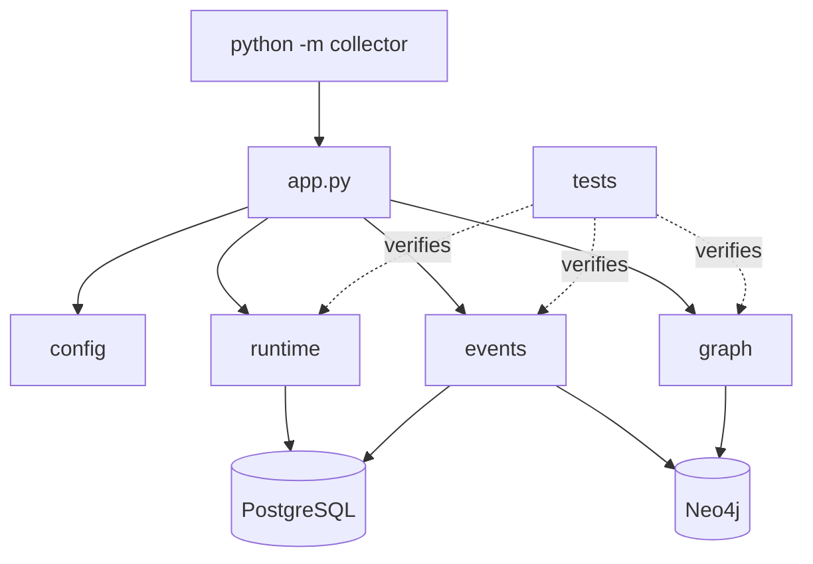

# Docker collector

The collector reconciles Docker's current containers with PostgreSQL and Neo4j, then listens for lifecycle events. Its modules are grouped by responsibility so the startup flow and data ownership are easy to follow.

## Folders

- `config/` loads connection settings and creates database connections.
- `database/` upserts logical services, containers, and initial status rows.
- `events/` parses Docker events, maps event states, stores history, and mirrors updates to Neo4j.
- `graph/` discovers Compose files and synchronizes service dependencies and container nodes.
- `runtime/` reconciles Docker's current container snapshot with both databases.
- `tests/` contains automated unit tests and two opt-in Docker inspection scripts.

Run from the repository root with `python -m collector`. The older `python collector/collector.py` entry point is kept for compatibility. Install dependencies with `python -m pip install -r collector/requirements.txt`.
