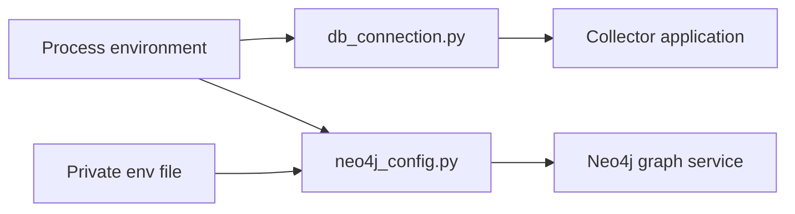

# Collector configuration

This folder owns connection setup only. PostgreSQL settings are read from the process environment. Neo4j settings are read from the process environment and can fall back to the user's private runtime-tracker env file.

Database credentials stay outside source files. `db_connection.py` opens PostgreSQL connections; `neo4j_config.py` validates Neo4j credentials before creating a driver.
