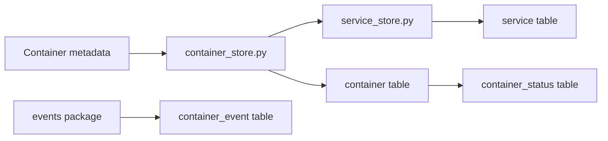

# PostgreSQL persistence

These modules contain small parameterized statements for logical service and container rows. They do not open connections; callers supply a PostgreSQL cursor so event inserts and state changes remain inside the caller's transaction.

Service identity is scoped by Compose project plus service name. Standalone container records reuse an existing service association when reconciled and do not gain inferred graph dependencies.
