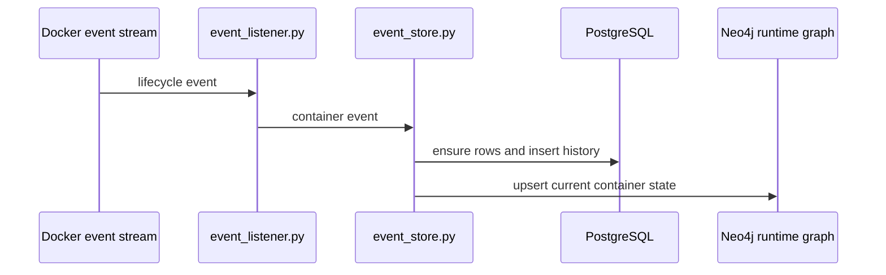

# Docker events

The event path filters Docker's stream to container lifecycle events, records each structured event in PostgreSQL, and updates the matching Neo4j container node when Neo4j is available.

`event_state.py` maps Docker actions to allowed runtime states. PostgreSQL remains the durable event history if Neo4j is temporarily unavailable. `docker_event_stream.py` is an opt-in manual inspection script, not an automated unit test.
