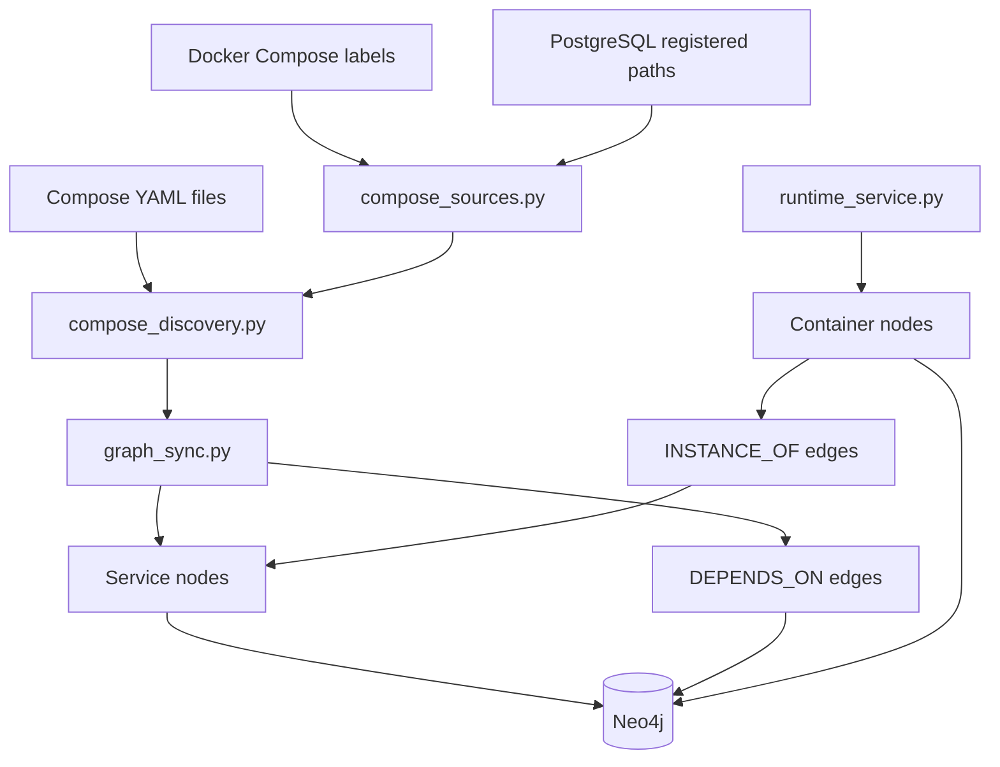

# Dependency and runtime graph

This folder builds the Neo4j model from Docker Compose labels/configuration and upserts actual container nodes. Compose `depends_on` is the only source of service dependency edges; networks and names are not used to infer dependencies.

`Service.service_id` is project-scoped. `Container.container_id` is the full Docker ID. Synchronization uses `MERGE`; unreadable Compose files are reported and marked unavailable without discarding the prior graph. Removed service nodes remain available as undiscovered history.
