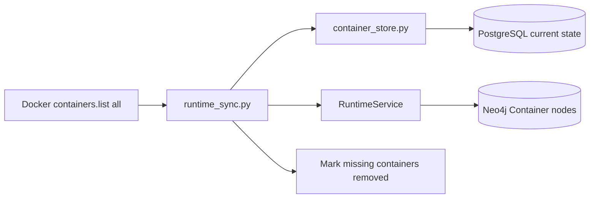

# Runtime reconciliation

`runtime_sync.py` reads Docker's existing containers, maps Docker states to the relational state constraint, upserts PostgreSQL records, and synchronizes container nodes in Neo4j. It also marks database records absent from Docker as removed while preserving their history.

The collector runs this reconciliation once at startup, before subscribing to new events. This repairs state after collector downtime.
