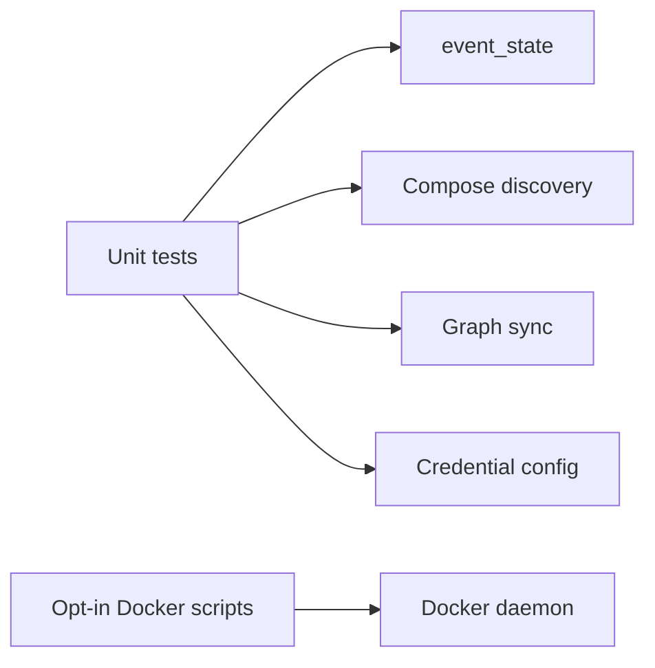

# Collector tests and smoke scripts

Run automated tests from the repository root:

```sh
python -m unittest discover -s collector/tests -p 'test_*.py'
```

The unit suite tests lifecycle mapping, project-aware IDs, Compose source discovery and merging, graph synchronization query construction, and Neo4j credential loading. `docker_connection_smoke.py` and `docker_event_stream.py` are manual scripts; they contact the Docker daemon and are intentionally excluded from unittest discovery.


