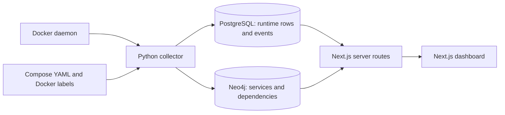
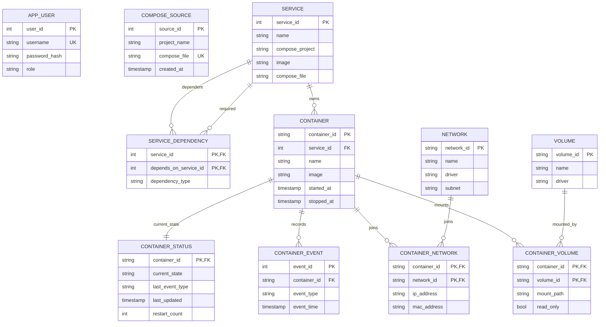
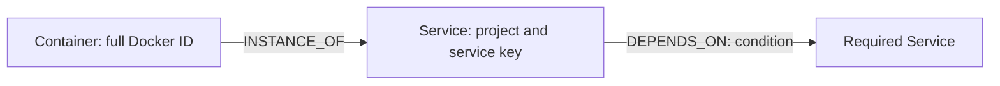

# Docker Runtime State and Dependency Tracking System

## Problem, motivation, and scope

Docker environments accumulate containers, replicas, and Compose projects. A list of current containers does not show lifecycle history or explain which logical services depend on one another. This project collects Docker runtime state and events, reads declared Compose `depends_on` relationships, and presents status and potential downstream impact through a web dashboard.

The system covers container discovery, lifecycle status/history, project-aware Compose service identity, declared dependency discovery, graph traversal, and viewer/admin access. It does not infer dependencies from network membership, container names, or observed event order. Impact means graph reachability and does not guarantee an outage will propagate.

## Functional requirements

1. Discover running and stopped Docker containers and reconcile current status.
2. Store lifecycle events and preserve rows when Docker removes a container.
3. Discover Compose project/service/file metadata from Docker labels.
4. Read one or more Compose YAML files and synchronize declared `depends_on` edges idempotently.
5. Register inaccessible Compose paths through the admin dashboard.
6. Display overview, dependency graph, containers, event history, and impact analysis.
7. Allow administrators to create accounts, change roles, and register Compose sources; viewers receive read-only dashboard access.

## Architecture and database choices

PostgreSQL stores constrained records that benefit from transactions, joins, aggregates, and event history. Neo4j stores the directed service graph and supports variable-length traversal for dependencies and possible impact. The Next.js server owns both database connections; browser components call API routes and never receive database credentials.

## PostgreSQL ER model

The `SERVICE` key is scoped by `(compose_project, name)`. `CONTAINER_EVENT` references use `ON DELETE RESTRICT`; service deletion is also restricted while a container references it, preserving the event trail. `removed` is a valid current state. `COMPOSE_SOURCE` is the admin-managed path registry. Network and volume tables are part of the relational model but are not currently populated by the collector.

## Relational data dictionary

| Table | Purpose | Important integrity rules |
| --- | --- | --- |
| `app_user` | Dashboard account and role | Unique username; password hash and role required; role is `ADMIN` or `VIEWER` |
| `compose_source` | Admin-registered Compose YAML paths | Primary key, unique path, nonempty project/path checks |
| `service` | Logical service identities | Unique project/name pair |
| `service_dependency` | Relational dependency relation available for SQL demonstrations | Composite primary key, two service foreign keys, no self-edge check |
| `container` | Actual Docker container identity and metadata | Full Docker ID primary key; service FK with delete restriction |
| `container_status` | One current state per container | Container FK, enumerated state check, nonnegative restart count |
| `container_event` | Append-only structured lifecycle history | Event/container keys, non-null type/time, restrictive container FK |
| `network`, `container_network` | Network metadata and container membership | Composite membership key and FKs |
| `volume`, `container_volume` | Volume metadata and mounts | Composite mount key and FKs |

`current_container_status`, `container_event_history`, and `container_network_details` are SQL views. `trg_container_event_status` updates current status and restart count after lifecycle event inserts. Supporting indexes are defined in `db/indexes.sql`. Run `db/demo_queries.sql` for live SELECT examples and rollback-scoped DML/DDL demonstrations; see `db/QUERY_GUIDE.md` for the concept mapping and captured PostgreSQL output.

## Neo4j graph model

`Service.service_id` uses `<compose project>:<service key>` and `Container.container_id` uses the full Docker ID. `DEPENDS_ON` points from the dependent to the service it requires. `INSTANCE_OF` joins actual replicas to one logical service. Standalone containers have no invented service/dependency edge. Removed containers remain with `status: removed`; services removed from a readable Compose file are marked `discovered: false` so historical instance edges remain inspectable.

Open `db/demo_queries.cypher` in Neo4j Browser to inspect nodes, relationships, direct and transitive traversal, independent services, path distances, shortest paths, constraints, and safe targeted graph maintenance. Live Cypher was verified against the running Neo4j database: `demo:frontend` returned direct dependency `api` and transitive dependencies `api`, `postgres`, and `redis`; selecting `demo:postgres` returned potential impact `api` at distance 1 and `frontend` at distance 2. A repeated sync held at 14 service nodes, 6 dependency edges, and 26 container nodes; 10 services were actively discovered. One labeled `sdn_mininet` project path was inaccessible and was reported as unavailable.

## Application and API

| Route | Source | Purpose |
| --- | --- | --- |
| `/` | PostgreSQL | Summary counts, recent events, searchable container rows |
| `/dependencies` | Neo4j | Project/service filters, dependencies, dependents, instances, source status |
| `/containers` | PostgreSQL | Search/state filters and container event detail panel |
| `/events` | PostgreSQL | Search/type/date filters, sorting, pagination |
| `/impact` | Neo4j | Direct/transitive requirements and potential affected services with distance |
| `/users`, `/settings` | PostgreSQL | Admin-only account/role and Compose-source management |

SQL and Cypher route values are parameterized. Event sort direction is selected from a fixed allowlist, and query filters are validated. Signed HTTP-only sessions use `AUTH_SECRET`; password hashes use Node's scrypt implementation. The first administrator is created by `dashboard/scripts/create-user.mjs`. Admin mutation routes recheck the current role in PostgreSQL; viewer access to `/api/admin/*` is denied.

## Testing and observed results

- Python unit tests: 11 passed, covering event-state mapping, Neo4j configuration, Compose independent/dependent services, multiple config-file merging, multiple project label discovery, project-scoped graph IDs, and idempotent `MERGE` query construction.
- Dashboard `npm run lint`: passed.
- Dashboard production `npm run build`: passed for all five viewer pages and admin routes.
- Authentication smoke test: temporary admin and viewer accounts signed in successfully; viewer container read returned HTTP 200, viewer admin settings returned HTTP 403, and admin settings returned HTTP 200. Temporary accounts were deleted afterward.
- PostgreSQL demo query collection: executed against the configured database; the DML and temporary DDL sections rolled back.
- PostgreSQL destroy/OOM trigger behavior: checked with transaction-scoped event inserts and rolled back.
- Live Docker lifecycle smoke test ran with a uniquely named BusyBox container. PostgreSQL recorded `create`, `start`, `kill`, `stop`, `die`, and `destroy`; state moved from `running` to `stopped` and then `removed`, with all seven event rows preserved. The first run exposed the `die → dead` mapping issue; it was corrected to `die → stopped` while `kill` and `oom` remain `dead`, then the test passed.
- With Neo4j online, a standalone BusyBox container appeared as a running `Container` node with zero `INSTANCE_OF` edges; after stop/removal, the graph retained it with `status: removed`, while PostgreSQL retained all seven lifecycle events.
- Authenticated live API smoke test returned HTTP 200 for Overview, Dependency Graph, Containers, Event History, and Impact Analysis. The real dependency API returned 10 active services; impact returned `api:1` and `frontend:2` for `demo:postgres`.

Capture current dashboard and Neo4j Browser screenshots during the live demonstration and add them here. Query output above was captured from the running Neo4j database; no screenshots are fabricated.

## Conclusion and future work

The project combines relational runtime history with graph-based declared dependencies and exposes both through a role-protected dashboard. Next steps include live Neo4j end-to-end verification, Docker daemon lifecycle tests, richer visual graph layout, collection of container labels/networks, account password reset, and automated browser tests.

## Setup

Follow the repository [README](../README.md) for environment variables, database migrations, collector startup, dashboard setup, and safe query demonstration commands.
